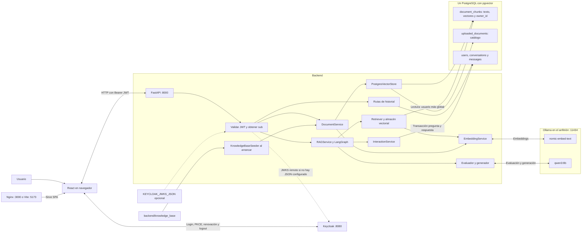
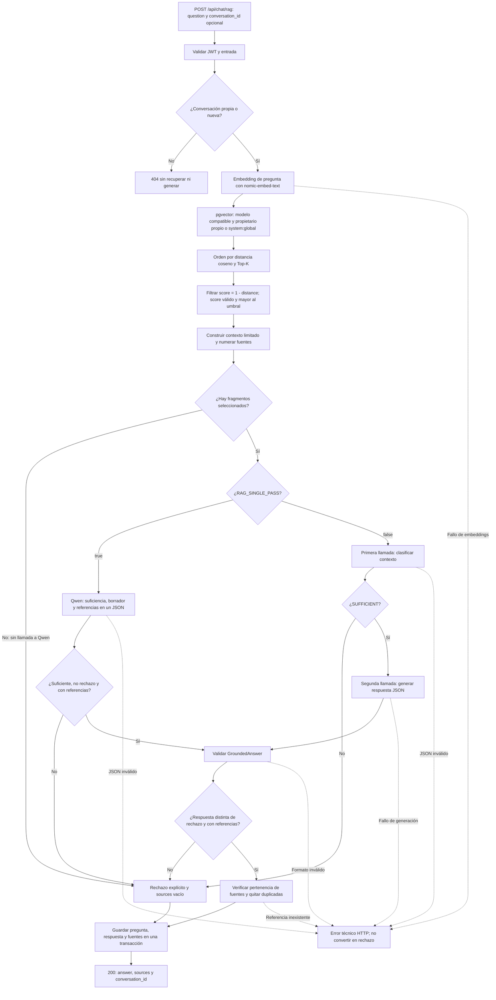
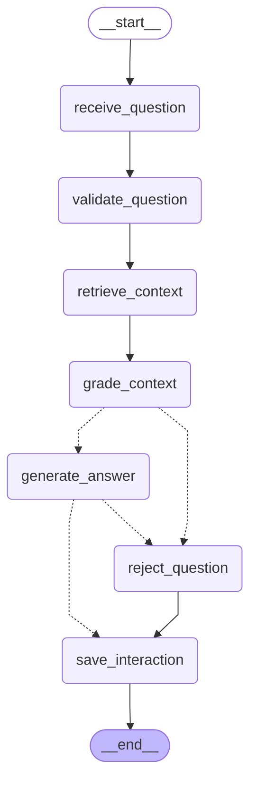
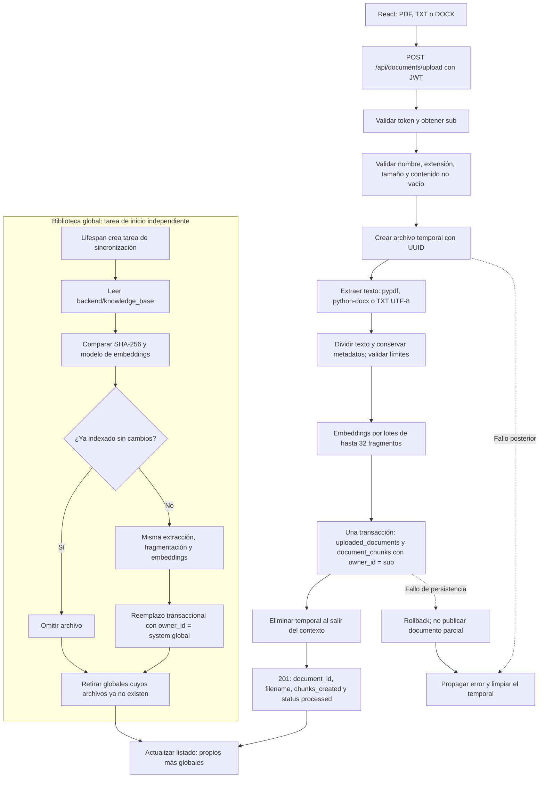

# Arquitectura del RAG Sports Agent — Fase 17

Revisión del código del 12 de octubre de 2026.
Equipo: **Miguel Zuleta, Sebastián Giraldo y Martín Restrepo**.

Este documento describe la implementación existente. El modo de referencia es
Docker Compose local: React servido por Nginx, FastAPI, PostgreSQL y Keycloak en
contenedores, y Ollama en el anfitrión. La preparación híbrida de fase 15 se explica
como alternativa, no como evidencia de un despliegue público activo.

## Diagramas y lectura

| Diagrama | Fuente editable | Qué representa |
|---|---|---|
| Arquitectura general | [architecture.mmd](diagrams/architecture.mmd) | Componentes y conexiones |
| Flujo RAG | [rag-flow.mmd](diagrams/rag-flow.mmd) | Recuperación, evaluación, generación, rechazo y persistencia |
| Grafo LangGraph | [agent-graph.mmd](diagrams/agent-graph.mmd) | Nodos y aristas obtenidos del grafo real |
| Carga de documentos | [document-upload.mmd](diagrams/document-upload.mmd) | Ingesta privada y sincronización global |
| Autenticación | [authentication.mmd](diagrams/authentication.mmd) | Login PKCE, JWT, renovación y logout |

Las versiones incluidas abajo son copias de los `.mmd` para que GitHub pueda
renderizarlas como bloques Mermaid. Al editar un diagrama, actualizar ambos.
Las flechas de arquitectura representan dependencias/intercambios, no orden temporal;
en los diagramas de flujo representan pasos. Las rutas de errores técnicas ilustran
salidas posibles y no enumeran cada excepción de cada servicio.

## 1. Arquitectura general



### Responsabilidades y despliegue local

| Componente | Responsabilidad | Código de referencia |
|---|---|---|
| React | Login, chat, fuentes, documentos e historial; estado privado y errores | [App.jsx](../frontend/src/App.jsx), [context](../frontend/src/context), [apiService](../frontend/src/services/apiService.js) |
| Nginx / Vite | Servir SPA compilada en 3000 o desarrollo en 5173 | [nginx.conf](../frontend/nginx.conf), [vite.config.js](../frontend/vite.config.js) |
| FastAPI | Contratos HTTP, dependencias de autenticación, CORS, errores y arranque | [main.py](../backend/app/main.py), [rutas](../backend/app/api/routes) |
| Keycloak | Identidad, sesión, emisión y renovación de tokens | [realm-export.json](../keycloak/realm-export.json) |
| RAGService / LangGraph | Comprobar acceso a conversación y coordinar respuesta | [rag_service.py](../backend/app/services/rag_service.py), [graph.py](../backend/app/agents/graph.py) |
| DocumentService | Extraer, fragmentar, vectorizar y persistir documentos | [document_service.py](../backend/app/services/document_service.py) |
| EmbeddingService | Embeddings de documentos y consultas con Ollama | [embedding_service.py](../backend/app/services/embedding_service.py) |
| LLMService | Generación asíncrona, timeout y métricas de Qwen | [llm_service.py](../backend/app/services/llm_service.py) |
| Almacén vectorial | SQL de catálogo, fragmentos, búsqueda y filtro de propietario | [postgres.py](../backend/app/vectorstore/postgres.py) |
| Historial | Propiedad, guardado transaccional y lectura de conversaciones | [interaction_service.py](../backend/app/services/interaction_service.py), [conversations.py](../backend/app/api/routes/conversations.py) |

Hay **una base PostgreSQL de la aplicación**, no dos motores distintos para vectores
e historial. El esquema contiene `document_chunks` y `uploaded_documents` (nombres
configurables), además de `users`, `conversations` y `messages`. El modelo heredado
`documents_history` existe, pero no es el catálogo utilizado por la carga actual.
Las fuentes del historial se almacenan como JSON serializado en una columna de texto.

Las cuentas y contraseñas se gestionan en Keycloak, con almacenamiento separado en
su volumen. La tabla `users` de la aplicación registra el sujeto necesario para el
historial, no sustituye a Keycloak. El [Compose](../docker-compose.yml) define las
conexiones internas: `postgres:5432`, `keycloak:8080` y `host.docker.internal:11434`.
El navegador usa las direcciones públicas locales, no los nombres de la red Docker.

## 2. Flujo RAG



1. La API valida la pregunta (1–2000 caracteres) y obtiene `user_id` del token.
   `RAGService.answer` comprueba la propiedad de una conversación existente **antes**
   de consultar embeddings o ejecutar el grafo. Una conversación ajena o inexistente
   produce 404. El cliente no elige el propietario.
2. El retriever calcula el embedding con `nomic-embed-text` y busca por distancia
   coseno en pgvector. Se filtra el modelo de embeddings y los propietarios antes
   del Top-K: `owner_id = sub` o `system:global`. Los registros heredados con NULL
   no son globales y no aparecen en una consulta autenticada.
3. El grafo exige puntuaciones válidas y `1 - distance > RAG_MIN_RELEVANCE_SCORE`.
   Construye un prompt con presupuesto de caracteres y numera los fragmentos elegidos.
   Si no queda contexto, rechaza sin invocar a Qwen; el embedding de consulta sí
   puede haberse calculado durante la recuperación.
4. Con `RAG_SINGLE_PASS=false`, Qwen clasifica suficiencia y, si es suficiente,
   una segunda llamada genera la respuesta. Con `true`, una llamada produce
   suficiencia, borrador y referencias; `generate_answer` reutiliza ese borrador
   de la misma petición, no una caché compartida entre usuarios.
5. Se valida la estructura y la pertenencia de referencias al contexto. Se quitan
   duplicadas. Un JSON inválido o referencia inexistente produce error técnico,
   no una cita inventada publicada. La pertenencia no demuestra por sí sola que
   el texto citado implique cada afirmación del modelo.
6. Respuesta y rechazo pasan por `save_interaction`. En una transacción se crea o
   comprueba la conversación, se registran pregunta y respuesta con fuentes y se
   actualiza su fecha. Si falla el guardado, no se devuelve una respuesta exitosa
   como si hubiera quedado persistida. La API devuelve `answer`, `sources` y
   `conversation_id` tras completar el servicio.

El historial se puede reabrir, pero **no se inyectan turnos anteriores en el prompt**.
No hay búsqueda web, memoria adicional ni otro agente externo. Los fallos de red,
modelo, tiempo o base de datos se manejan como errores; el grafo no garantiza el
guardado de una interacción fallida antes de alcanzar `save_interaction`.

Fuentes: [retriever](../backend/app/services/rag_retriever.py),
[prompt](../backend/app/services/rag_prompt.py), [evaluador](../backend/app/services/context_grader.py),
[fuentes](../backend/app/services/rag_sources.py) y [contratos](../backend/app/schemas/rag.py).

## 3. Grafo LangGraph



Este diagrama se genera con `build_graph(...).get_graph().draw_mermaid()`, sin ejecutar
el modelo ni acceder a la base. Las líneas condicionales del generador no muestran
etiquetas; sus condiciones están en `route_context` y `route_answer`:

| Nodo | Salida o decisión |
|---|---|
| `receive_question` | Reinicia datos derivados de la petición y conserva IDs |
| `validate_question` | Valida/normaliza la pregunta |
| `retrieve_context` | Recupera fragmentos autorizados |
| `grade_context` | Filtra, limita contexto y evalúa; `context_sufficient` decide la rama |
| `generate_answer` | Genera o reutiliza borrador y valida; `needs_rejection` lleva al rechazo |
| `reject_question` | Texto de rechazo definido en el esquema y fuentes vacías |
| `save_interaction` | Persiste ambas ramas antes de END |

Los dos modos de inferencia usan **los mismos nodos**. Cambia el trabajo dentro de
`grade_context` y `generate_answer`, no la topología. Ver [estado](../backend/app/agents/state.py)
y [nodos](../backend/app/agents/nodes/rag_nodes.py).

## 4. Carga e indexación



La carga privada ocurre durante la petición HTTP, no en una cola externa. Se crea
un archivo temporal con nombre interno UUID, se extraen PDF/TXT/DOCX y se conserva
la página cuando corresponde. El chunking valida tamaño, solapamiento y límites.
Se calculan embeddings en lotes de hasta 32 fragmentos; solo después se publican
catálogo y todos los fragmentos en una transacción. `FileStorage.temporary` limpia
el archivo al salir, también ante errores posteriores a su creación. No hay
almacenamiento permanente ni descarga de originales por la API actual.

La base común usa una tarea asíncrona del lifespan: `KnowledgeBaseSeeder` revisa
SHA-256 y modelo antes de indexar. Reutiliza la preparación documental, pero reemplaza
la versión global en una transacción; no elimina el original versionado. Después
retira registros globales de archivos ausentes. Una carpeta inexistente no dispara
el borrado. La sincronización tiene reintentos y puede terminar después de que
`/health` ya responda; no es un servicio independiente ni un worker de colas.

El listado combina globales con privados propios y marca `is_global`. Sustituir o
retirar un documento global no debe afectar al privado con el mismo nombre.

Fuentes: [temporales](../backend/app/services/file_storage.py),
[extracción](../backend/app/services/text_extraction.py),
[fragmentación](../backend/app/services/chunking_service.py),
[sincronización](../backend/app/services/knowledge_base.py).

## 5. Autenticación y autorización

```mermaid
sequenceDiagram
    actor U as Usuario
    participant R as React y keycloak-js
    participant K as Keycloak
    participant A as FastAPI
    participant S as security.py
    participant D as PostgreSQL
    R->>K: check-sso al iniciar
    U->>R: Iniciar sesión
    R->>K: Authorization Code, state y PKCE S256
    U->>K: Credenciales en formulario de Keycloak
    K-->>R: Redirección con código
    R->>K: Intercambiar código y code_verifier
    K-->>R: Tokens; adaptador los mantiene en memoria
    U->>R: Consultar API protegida
    R->>R: updateToken(30)
    opt Renovación necesaria
        R->>K: Renovar token
        K-->>R: Nuevos tokens o error
    end
    Note over R,K: Si falla la renovación, limpiar sesión; no continuar la consulta
    R->>A: HTTP Authorization Bearer access_token
    A->>S: get_current_user en threadpool
    alt KEYCLOAK_JWKS_JSON configurado
        S->>S: Elegir clave pública del JSON por kid
    else JWKS remoto
        S->>K: Obtener clave vía PyJWKClient con caché
        K-->>S: Claves públicas
    end
    S->>S: Validar RS256, iss, aud, exp, iat, azp, typ y sub UUID
    alt Token válido
        S-->>A: sub del usuario
        A->>D: Filtrar por propietario; incluir globales en documentos
        D-->>A: Datos autorizados
        A-->>R: Resultado de la operación
    else Token inválido
        S-->>A: HTTP 401
        A-->>R: 401; interfaz limpia sesión
    else Consulta remota de claves no disponible
        S-->>A: HTTP 503
        A-->>R: Error controlado
    end
    U->>R: Cerrar sesión
    R->>R: Crear URL de logout y limpiar tokens/estado privado
    R->>K: Logout con retorno a /login
    K-->>R: Volver al login
```

El diagrama representa el navegador. El adaptador se inicializa con `check-sso`,
PKCE S256 y tokens en memoria. Antes de cada llamada la capa API solicita un token
con al menos 30 segundos de validez; un fallo de renovación impide continuar.
Un 401 limpia la sesión y aborta peticiones pendientes. Cerrar sesión limpia el
estado privado y redirige al logout de Keycloak con retorno al login.

FastAPI obtiene claves desde `KEYCLOAK_JWKS_JSON` si se configura; de lo contrario
usa `PyJWKClient` y su caché contra el JWKS remoto. Leer `kid` sin verificar sirve
solo para seleccionar clave: luego se valida la firma RS256 y los claims. `sub`
debe ser UUID, `azp` debe coincidir con el cliente y `typ` debe ser Bearer. El emisor
esperado puede separarse de la URL interna mediante `KEYCLOAK_ISSUER_OVERRIDE`.
Las claves JSON requieren actualización si Keycloak las rota.

La autenticación identifica al usuario; el filtro SQL y las comprobaciones de
propiedad autorizan documentos e historial. Una conversación ajena devuelve 404.
Un fallo al consultar JWKS remoto produce 503; un token inválido produce 401.
Las rutas de health y documentación son públicas. Swagger usa el flujo de contraseña
con `OAuth2PasswordBearer`, distinto del login PKCE del frontend.

Fuentes: [authService](../frontend/src/services/authService.js),
[apiService](../frontend/src/services/apiService.js),
[security.py](../backend/app/core/security.py), [configuración](../backend/app/core/config.py).
El export contiene actualmente orígenes comodín incompatibles con una prueba de
seguridad existente; se conserva como limitación documentada, no como garantía de
configuración de producción segura. Ver [README](../README.md#tests).

## Alternativa híbrida y límites de los diagramas

La preparación de fase 15 permite frontend/backend/base remotos y Ollama local a
través de `scripts/tunnel/ollama_proxy.py` más un túnel. `OLLAMA_API_KEY` añade un
Bearer entre backend y proxy. Es opcional y no interviene en Compose local.
La disponibilidad sigue dependiendo del equipo que ejecuta Ollama y, si aplica,
Keycloak. No se representa un despliegue remoto activo sin evidencia.

Los diagramas no incorporan componentes inexistentes como Redis, Celery, OCR,
almacén de objetos, memoria conversacional, búsqueda web o un proveedor LLM de pago.
Tampoco suponen que los controles eliminan todas las alucinaciones ni que el health
comprueba todos los servicios. Consultar [límites actuales](../README.md#limitaciones-y-diagnóstico).

## Visualización y mantenimiento

Abrir este documento en GitHub o en una vista Markdown compatible con Mermaid.
Los `.mmd` son fuentes de texto editables, no imágenes; un visor sin Mermaid
mostrará el código. No se necesita arrancar Docker, Ollama ni el backend para leerlos.

Para regenerar solo el grafo desde `backend/`, con el entorno existente:

```powershell
@'
from pathlib import Path
from app.agents.graph import build_graph, graph_mermaid
graph = build_graph(None, None, None, None)
Path('../docs/diagrams/agent-graph.mmd').write_text(graph_mermaid(graph).rstrip() + '\n', encoding='utf-8')
'@ | .venv\Scripts\python.exe -
```

Actualizar después el bloque correspondiente de este documento. El resto son
diagramas explicativos: cotejarlos con los archivos enlazados cuando cambie el flujo.
Esta fase modifica documentación, no el comportamiento de la aplicación.
